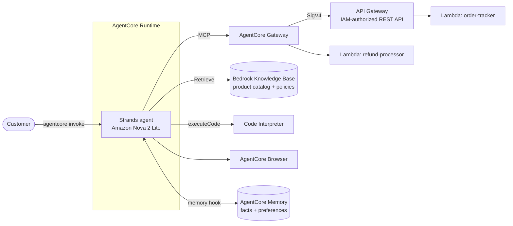

# AI support agent on Amazon Bedrock AgentCore

A customer-support agent that tracks orders, processes refunds, answers product and policy questions from a knowledge base, calculates loyalty discounts in a sandbox, browses the web and remembers customers across sessions. It's one **Strands** agent on **AgentCore Runtime**, using five AgentCore capabilities: Gateway, Memory, Code Interpreter, Browser and a Bedrock Knowledge Base.


> Final project of the *Building Agents with Amazon Bedrock AgentCore and Strands SDK* course in Udacity's
> [Future AWS Agent Engineer Nanodegree](https://www.udacity.com/scholarships/aws-ai-ml-scholars).
> My notes and the other projects from the program: **[aws-agent-engineer-notes](https://github.com/ahmedEid1/aws-agent-engineer-notes)**.

## Origin

Built for the Future AWS Agent Engineer Nanodegree on Udacity's starter code ([udacity/cd14763-project-starter](https://github.com/udacity/cd14763-project-starter)).

- **From the starter, unchanged:** the two Lambda functions and the Gateway tool schema in `agent/lambda/`, `agent/product_catalog.txt` and `agent/setup_permissions.py`. The six test scenarios are the ones the starter's instructions set.
- **From the starter, completed by me:** `agent/main.py` came with its imports and TODOs. I wrote the system prompt, the model and client setup, the memory hook, the knowledge-base and loyalty-discount tools, and the entrypoint that loads the Gateway and Browser tools.
- **Mine:** the backend scripts in `infra_setup/`, the `offline_checks/` suite, the transcripts and logs of the live run in `test_outputs/`, and `docs/REFLECTION.md`.

## Architecture



| Capability | How it's built |
|---|---|
| Order tracking and refunds | Six tools discovered over MCP from **AgentCore Gateway**, from two targets: an **IAM-authorized API Gateway REST API** (the gateway signs with SigV4) and a **Lambda** target |
| Product and policy answers | `search_knowledge_base`: `Retrieve` on a managed **Bedrock Knowledge Base** |
| Loyalty discounts | `calculate_loyalty_discount`: exact arithmetic in the **AgentCore Code Interpreter**, with a clearly-flagged fallback if the sandbox is down |
| Live web pages | **AgentCore Browser** tool (Playwright) |
| Personalization | A Strands **hook**: recalls semantic facts and user preferences from **AgentCore Memory** before each message, and saves each finished turn |

## Results: 6/6 scenarios against the deployed runtime

| # | Scenario | What came back ([transcripts](test_outputs/)) |
|---|---|---|
| 1 | Order tracking (Gateway → API Gateway) | Shipped via UPS, tracking number, estimated delivery |
| 2 | Refund (Gateway → Lambda) | Refund `REF-…` approved for $139.99, 3–5 business days |
| 3 | Knowledge base (RAG) | Platinum benefits: free same-day shipping, 15% discount, priority support |
| 4 | Memory across sessions | New session: *"Yes, Jane. I remember you prefer concise responses."* (2 facts + 1 preference recalled) |
| 5 | Loyalty math (Code Interpreter) | 4,000 points redeemed ($40), 10% Gold discount, **$99.00** final, 250 points left |
| 6 | Browser | Read the live page title of a website |

`test_outputs/runtime_logs.txt` shows the tool calls on the runtime: `order-tracker___get_order`, `refund-processor___initiate_refund`, `search_knowledge_base`, `calculate_loyalty_discount`, `browser`, and the memory-recall lines.

**25 offline checks** (`offline_checks/`) cover the same logic with no AWS account:
- the memory hook's recall and save;
- the knowledge-base tool against a botocore Stubber;
- the discount script, executed in a local subprocess;
- the entrypoint's Gateway degradation.

## Engineering notes

- **Untrusted tool input.** The loyalty tool builds a Python script from the model's arguments. Tier and category are validated against fixed lists and the amounts are coerced to numbers *before* the script is built, so a crafted argument can't inject code. Each calculation runs in its own Code Interpreter session (with `clearContext=True` as well), so nothing carries over between customers.
- **Memory without feedback loops.** The hook saves the customer's *original* message, not the version with recalled context prepended, so memories aren't re-extracted from themselves. It logs recall counts only, never memory contents.
- **Graceful degradation.** The Gateway session is opened in an `ExitStack`. If the Gateway is down, the agent still answers with the knowledge base, calculator and browser.
- **Problems I hit and fixed while deploying:**
  - Gateway target names can't contain `_`.
  - An API Gateway target needs declared method responses: the Gateway imports the API through its OpenAPI export.
  - Deploying from Windows pinned the Windows-only `pywin32` (fixed with a Linux-safe `requirements.txt`) and dropped Unix exec bits from the dependency zip, which broke Playwright's driver on the runtime. `infra_setup/fix_zip_permissions.py` fixes the zip.
  - Long-term memory extraction is asynchronous, so the memory test waits about 90 s between sessions.

More in the [reflection](docs/REFLECTION.md), including what I'd change for production: a JWT (Cognito) authorizer on the Gateway and the Runtime instead of `NONE`, and a customer ID taken from a verified token.

> Deployed and verified in September 2026. The AWS resources have since been torn down.

## Repository layout

```text
agent/main.py               the agent: tools, memory hook, entrypoint (my implementation)
agent/requirements.txt      runtime dependencies for `agentcore configure --requirements-file`
agent/setup_permissions.py  grants the runtime role access to Gateway, KB, Memory, Code Interpreter, Browser
agent/lambda/               order-tracker and refund-processor Lambdas + the Gateway tool schema
infra_setup/                my scripts: build/teardown the backend, run the 6 live tests, fix the zip
offline_checks/             25 offline checks (no AWS needed)
test_outputs/               transcripts of the live test run + runtime logs
docs/REFLECTION.md          design decision, challenge, production considerations
```

## Run it

Prerequisites: AWS credentials for `us-east-1` with Bedrock access to Amazon Nova 2 Lite; Python 3.13 and `uv`.

```bash
cd agent && uv sync

# Offline checks: no AWS account needed
uv run python ../offline_checks/test_main_offline.py

# Build the backend: Lambdas, REST API, Gateway + targets, Knowledge Base, Memory.
# It prints GATEWAY_URL, KB_ID and MEMORY_ID; set them as environment variables
# (or in the placeholders at the top of agent/main.py).
uv run python ../infra_setup/build_backend.py

# Deploy with the AgentCore starter toolkit, then grant the runtime role its permissions
uv run agentcore configure --entrypoint main.py --requirements-file requirements.txt --non-interactive
uv run agentcore deploy
# Deploying from Windows? Run ../infra_setup/fix_zip_permissions.py after the first deploy, then deploy again
uv run python setup_permissions.py

# Run the six live scenarios (transcripts go to test_outputs/)
uv run python ../infra_setup/run_tests.py

# Tear down
uv run agentcore destroy --force && uv run python ../infra_setup/teardown_backend.py --yes
```

## Credits and license

[Origin](#origin) lists which parts came from Udacity's starter and which are mine. Udacity's starter material is licensed under the terms in [LICENSE.txt](LICENSE.txt) (CC BY-NC-ND with Udacity's modifications).
